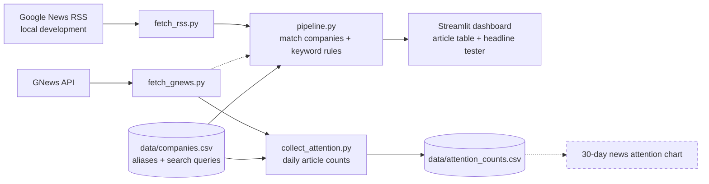

# ChipWatch AI
### Evidence-Linked Semiconductor Supply Disruption Monitoring

**Status:** In development (Phase 1: data collection and dashboard)  
**Focus:** Semiconductor supply chain · Risk intelligence · Data analytics · Machine learning

ChipWatch AI collects public news about six real semiconductor companies, matches each headline to the companies it mentions, and flags headlines that may describe supply disruptions, so analysts can review evidence faster. Every flag links back to its original source and is treated as a lead for human review, not a confirmed risk.

> 📸 *Dashboard screenshot and live demo link will be added once the dashboard is deployed.*

---

## Current Status

| Component | Status |
|---|---|
| Python environment, project structure, and safe API key handling (`.env`) | ✅ Done |
| Verified company reference file with per-company search queries (`data/companies.csv`) | ✅ Done |
| Company name matching (`src/match_companies.py`) | ✅ Done, with tests |
| Keyword-based disruption rules (`src/classify_rules.py`) | ✅ Done, with tests |
| Matching + rules pipeline (`src/pipeline.py`) | ✅ Done |
| Streamlit dashboard: company selector, details, headline tester | ✅ Done |
| Source-linked article table with company matches and flags | ✅ Working locally (Google News RSS) |
| GNews fetcher: articles and daily article counts (`src/fetch_gnews.py`) | ✅ Done |
| 30-day news attention data collection (`scripts/collect_attention.py`) | 🔄 In progress (limited by free API quota) |
| 30-day news attention chart in the dashboard | ⬜ Next |
| Hand-labeled headlines and machine learning classifier | ⬜ Planned |
| Public deployment | ⬜ Planned |

---

## Problem

Semiconductor supply chain analysts monitor fragmented external information (manufacturing incidents, trade restrictions, logistics problems, company announcements) spread across many news sources. Collecting and screening this manually is slow and inconsistent.

**Guiding question:** How can AI help supply chain analysts detect, prioritize, and investigate external semiconductor supply disruptions faster and more systematically?

## Solution

ChipWatch AI is designed to:

1. Collect semiconductor industry news from public sources.
2. Identify which monitored companies each headline mentions.
3. Flag headlines that may describe a disruption, starting with transparent keyword rules and later a trained classifier.
4. Show news attention over time separately from reviewed disruption events.
5. Present a source-linked review queue for analysts.

The platform supports human decision-making. It does not replace professional risk assessment.

---

## How It Works



*Dashed boxes and arrows are planned and not yet built.*

**Pipeline steps:**

1. **Fetch:** retrieve recent headlines, links, publishers, and publication dates for a company's search query.
2. **Match companies:** detect which of the six monitored companies each headline names, using hand-researched aliases and whole-word, case-insensitive matching.
3. **Flag:** check each headline for disruption clue phrases (Manufacturing, Geopolitical, Logistics, Financial). Each flag shows the exact phrases that triggered it. Headlines matching several categories are marked "Needs review."
4. **Review:** every result starts as "Unreviewed" and links to its original source for a human to verify.

**Key distinction:** a spike in news attention can come from earnings reports, product launches, or repeated coverage of one story. ChipWatch labels article volume as **news attention**, never as risk.

---

## Companies Monitored

| Company | Segment | News search query |
|---|---|---|
| TSMC | Foundry | `TSMC` |
| ASML | Semiconductor Equipment | `ASML` |
| SK hynix | Memory | `SK hynix` |
| Micron | Memory | `Micron Technology` |
| Amkor | Assembly Packaging & Test | `Amkor` |
| Samsung Electronics | Memory; Foundry | `Samsung Electronics AND (chip OR memory OR foundry)` |

Segments are verified against each company's official website, with the source link and verification date stored in `data/companies.csv`. Being in a related segment does not establish a customer-supplier relationship between these companies.

Each company has its own search query because one formula does not fit all names: "Micron" alone matches the unit of measurement, and "Samsung Electronics" alone matches phone and TV news.

---

## Early Findings

These are observations from testing on real data, not formal evaluation results.

- **Filtering works at scale.** Of 100 real TSMC headlines, the keyword rules flagged **1** for review (a plant resuming operations after an earthquake). The other 99 were ordinary business news, such as earnings, share trades, and new fabs.
- **News attention is not risk.** TSMC's daily article count jumped from **1** on a quiet Sunday to **30** on its quarterly earnings day. The spike was real, but it reflected earnings, not a disruption.
- **Data-driven alias decision.** Plain "Samsung" was originally excluded from aliases to avoid consumer electronics news. Testing on 67 real Samsung headlines showed this missed **37 (55%)** of relevant articles, because chip journalism usually says just "Samsung." Since the search query already filters out consumer news, plain "Samsung" was added back.
- **Query wording matters.** For TSMC on its earnings day, searching `TSMC` returned **51** articles versus **30** for `TSMC semiconductor`, which led to per-company queries.
- **Duplicate coverage is common.** Wire stories appear many times across publishers (one Samsung story appeared 4 times in a single result set), which is why article counts and event counts must be kept separate.
- **Chart spikes can be traced to their cause in seconds.** ASML's coverage jumped from 0–2 articles a day to **46** on October 14; the article table showed the cause was its quarterly earnings report, not a disruption.

---

## Known Limitations

ChipWatch AI uses only publicly available information. It does not have access to confidential supplier relationships, private inventory levels, customer-specific sourcing, or undisclosed manufacturing capacity.

**Interpretation**
- News coverage does not necessarily indicate actual supply risk, and higher article volume does not mean higher severity.
- A company being mentioned does not prove it is directly affected.
- The platform does not predict shortages or production losses.

**Company matching**
- Matching uses headlines only, so relevant articles that don't name a company in the headline are missed.
- Some names have other meanings (e.g., "micron" as a unit of measurement, "Samsung Electro-Mechanics" as a separate company), producing occasional false matches.

**Keyword rules**
- Rules cannot understand negation ("TSMC avoids shutdown"), paraphrase ("fab halted after blaze"), hypotheticals ("Will new sanctions hit ASML?"), or context ("earthquake drill"). These failures are documented as tests and are the motivation for a trained classifier in Phase 2.

**Data sources**
- GNews's free plan allows about 100 requests per day and up to 10 articles per request, and delays articles by roughly 12 hours, so the public dashboard is not real-time.
- GNews daily counts are much smaller than total coverage, so the attention chart is best read as changes over time for one company, not as a comparison between companies.
- Only article metadata (headlines, links, dates, publishers) is stored, never full article text.

---

## Data Sources

| Source | Used for | Status |
|---|---|---|
| [GNews API](https://gnews.io/) | Headlines and daily article counts | ✅ In use |
| [Google News RSS](https://news.google.com/) | Recent headlines during local development | ✅ Local only (feed terms limit use to personal, non-commercial readers) |
| [GDELT DOC 2.0 API](https://www.gdeltproject.org/) | Originally planned for news attention timelines | ⏸️ Paused: persistent rate limiting (Oct 2026). Code kept in `src/fetch_gdelt.py`. |
| Official company websites ([TSMC](https://www.tsmc.com/english/aboutTSMC/company_profile), [ASML](https://www.asml.com/en-us/about-asml/company-profile), and others) | Verifying company segments | ✅ In use |
| [SEC EDGAR](https://www.sec.gov/edgar/search/) | Official company filings | ⬜ Planned |

**Why the data source changed:** GDELT's free API began rejecting requests from every network tested, even after waiting for hours, consistent with an extended cooldown. After comparing five free news APIs (GNews, NewsAPI.org, NewsData.io, Finnhub, Marketaux), GNews was chosen as the only option that could be deployed publicly for non-commercial use, supported keyword search across all six companies, and offered 30 days of history. Google News RSS is used only for local development.

News data provided by [GNews](https://gnews.io/).

---

## Project Structure

```
ChipWatch-AI/
├── app.py                      # Streamlit dashboard
├── requirements.txt            # Python dependencies
├── .env.example                # Template for the GNews API key (.env itself is not committed)
├── data/
│   └── companies.csv           # Verified companies, aliases, segments, search queries
├── src/
│   ├── fetch_gnews.py          # GNews articles and daily counts
│   ├── fetch_rss.py            # Google News RSS (local development only)
│   ├── fetch_gdelt.py          # GDELT fetcher (paused)
│   ├── queries.py              # Shared per-company search query lookup
│   ├── match_companies.py      # Company name matching
│   ├── classify_rules.py       # Keyword-based disruption flags
│   └── pipeline.py             # Runs matching and rules on articles
├── scripts/
│   ├── collect_attention.py    # Resumable 30-day attention count collector
│   └── try_*.py                # Manual test scripts for each component
└── tests/
    ├── test_match_companies.py # 10 tests
    └── test_classify_rules.py  # 9 tests, including documented limitations
```

---

## Getting Started

Requires Python 3.13 and Git. Commands below are for Windows PowerShell.

**1. Clone and install**

```powershell
git clone https://github.com/uhbreadking/ChipWatch-AI.git
cd ChipWatch-AI
py -3.13 -m venv .venv
.\.venv\Scripts\Activate.ps1
python -m pip install -r requirements.txt
```

If activation is blocked, run `Set-ExecutionPolicy -Scope Process -ExecutionPolicy Bypass` first (this applies only to the current terminal).

**2. Add your GNews API key**

Get a free key at [gnews.io](https://gnews.io/), copy `.env.example` to a new file named `.env`, and replace the placeholder with your key:

```
GNEWS_API_KEY=your_gnews_api_key_here
```

**3. Run the dashboard**

```powershell
python -m streamlit run app.py
```

**4. Run the tests**

```powershell
python -m pytest
```

**5. Collect news attention data (optional)**

```powershell
python -m scripts.collect_attention
```

The collector stops after 80 requests to stay within the free plan's daily limit. Run it again the next day to continue; it skips data already collected.

---

## Tech Stack

| Technology | Purpose |
|---|---|
| Python 3.13 | Data processing and application logic |
| requests | API calls |
| pandas | Data cleaning and transformation |
| Streamlit | Interactive dashboard |
| python-dotenv | Loading the API key from `.env` |
| pytest | Automated testing |
| scikit-learn | Headline classification (planned) |
| Plotly | Charts (planned) |
| Git & GitHub | Version control |

---

## Roadmap

### Phase 1: Data Collection and Dashboard
- [x] Configure Python development environment
- [x] Create project structure
- [x] Build verified company reference file
- [x] Match company names in headlines (with tests)
- [x] Build dashboard layout with company selector and headline tester
- [x] Retrieve real semiconductor news articles (GNews; Google News RSS for local development)
- [x] Display source-linked articles in Streamlit *(working locally)*
- [ ] Collect 30 days of daily article counts *(in progress)*
- [ ] Build 30-day news attention chart
- [ ] ~~Connect to the GDELT API~~ *(paused: rate limiting)*

### Phase 2: Disruption Identification
- [x] Define disruption categories
- [x] Implement keyword-based classification (with tests documenting known limitations)
- [ ] Write labeling guidelines
- [ ] Hand-label 150–200 headlines
- [ ] Train and evaluate a machine learning classifier against the keyword-rule baseline

### Phase 3: Event Review and Prioritization
- [ ] Group duplicate and related articles into distinct events
- [ ] Build the prioritization framework
- [ ] Build the analyst investigation queue with review status

### Phase 4: Deployment and Evaluation
- [ ] Deploy to Streamlit Community Cloud (API key stored in Streamlit secrets)
- [ ] Benchmark manual vs. assisted news screening time
- [ ] Publish results and limitations

## Evaluation Plan

Formal results will be reported here only after testing on held-out, hand-labeled data.

| Metric | What it measures |
|---|---|
| Precision and recall | How accurately disruption headlines are flagged |
| Macro F1-score | Performance balanced across all categories |
| Company match precision and recall | How often company detection is correct, and how many mentions it finds |
| Duplicate event rate | How well repeated coverage is grouped |
| Screening time | Manual vs. tool-assisted review of the same headlines |
| Source traceability | Share of flagged events with working source links |

## Future Enhancements

- Scheduled daily data collection
- Matching on article descriptions, not just headlines
- Collapsing duplicate wire stories into one row with an outlet count
- LLM-assisted event extraction and source-linked briefings
- Expanded company coverage and alerts

---

## About

ChipWatch AI is an independent portfolio project combining semiconductor industry research, supply chain management, machine learning, and business intelligence. Its goal is to show practical AI development and the ability to turn unstructured industry news into useful, evidence-backed supply chain insights.