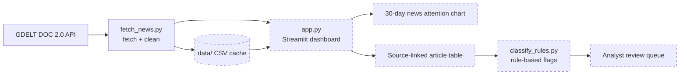

# ChipWatch AI
### Evidence-Linked Semiconductor Supply Disruption Monitoring

**Status:** In development (Phase 1: data collection)  
**Focus:** Semiconductor supply chain · Risk intelligence · Data analytics · Machine learning

ChipWatch AI collects public news about six real semiconductor companies, tracks how much coverage each one receives over time, and flags headlines that may describe supply disruptions, so analysts can review evidence faster. Every flag links back to its original source and is treated as a lead for human review, not a confirmed risk.

> 📸 *Dashboard screenshot and live demo link will be added once the first Streamlit version is deployed.*

---

## Current Status

| Component | Status |
|---|---|
| Python environment and project structure | ✅ Done |
| GDELT news attention fetcher (`src/fetch_news.py`) | 🔄 Code written; testing paused due to GDELT rate limits |
| Article list fetcher (headlines and source links) | ⬜ Next |
| Streamlit dashboard with 30-day news attention chart | ⬜ Waiting on GDELT data |
| Rule-based disruption flagging | ⬜ Planned |
| Machine learning classifier | ⬜ Planned |

---

## Problem

Semiconductor supply chain analysts monitor fragmented external information (manufacturing incidents, trade restrictions, logistics problems, company announcements) spread across many news sources. Collecting and screening this manually is slow and inconsistent.

**Guiding question:** How can AI help supply chain analysts detect, prioritize, and investigate external semiconductor supply disruptions faster and more systematically?

## Solution

ChipWatch AI is designed to:

1. Collect semiconductor industry news from public sources.
2. Identify which monitored companies each article mentions.
3. Flag headlines that may describe a disruption, starting with transparent keyword rules and later a trained classifier.
4. Show historical news attention separately from reviewed disruption events.
5. Present a prioritized, source-linked review queue for analysts.

The platform supports human decision-making. It does not replace professional risk assessment.

---

## How It Works



*Dashed boxes are planned and not yet built.*

**Key distinction:** a spike in news attention can come from earnings reports, product launches, or repeated coverage of one story. ChipWatch labels article volume as **news attention**, never as risk. Disruption flags are shown only after classification, and are marked unreviewed until an analyst checks the source.

---

## Companies Monitored

Six real companies covering different stages of the semiconductor supply chain:

| Company | Segment |
|---|---|
| TSMC | Foundry |
| ASML | Lithography and manufacturing equipment |
| SK hynix | Memory (DRAM / HBM) |
| Micron Technology | Memory (DRAM / NAND) |
| Amkor Technology | Assembly, packaging, and test |
| Samsung Electronics | Memory and foundry |

Company details are verified against official disclosures and investor relations materials. Being in a related segment does not establish a customer-supplier relationship between these companies.

---

## Planned Features

- **News monitoring:** retrieve articles with titles, publication dates, publishers, and source URLs; match company names and aliases; remove duplicate articles.
- **Disruption classification:** sort headlines into Manufacturing, Geopolitical / Trade, Logistics, Financial, or Non-disruptive. Keyword rules first, then a TF-IDF + logistic regression model trained on hand-labeled headlines.
- **Trend analysis:** chart news attention over time and compare companies, with article counts kept separate from distinct, reviewed events.
- **Event grouping:** combine multiple articles about the same incident into one event record.
- **Review prioritization:** rank events for investigation using documented factors (severity, evidence quality, recency, operational relevance), with visible reasons and analyst override.
- **Interactive dashboard:** company selector, news feed, attention charts, category filters, and an investigation queue with source links.

---

## Scope and Limitations

ChipWatch AI uses only publicly available information. It does not have access to confidential supplier relationships, private inventory levels, customer-specific sourcing, or undisclosed manufacturing capacity.

- News coverage does not necessarily indicate actual supply risk.
- Higher article volume does not mean higher disruption severity.
- A company being mentioned does not prove it is directly affected.
- Review priority scores are triage aids, not probabilities of supplier failure.
- The platform does not predict shortages or production losses.
- GDELT is a free public service with strict rate limits and occasional downtime; the app will fall back to cached sample data when it is unavailable.
- Only article metadata (headlines, links, dates) is stored, never full copyrighted article text.
- Samsung Electronics also sells consumer electronics, so some Samsung results may not relate to semiconductors. Searches are narrowed with chip-related keywords, and remaining false matches are handled during analyst review.

Hypothetical supply chain simulations are excluded from the MVP.

---

## Project Structure

```
ChipWatch-AI/
├── app.py               # Streamlit dashboard (in progress)
├── requirements.txt     # Python dependencies
├── src/
│   └── fetch_news.py    # GDELT requests and data cleaning
├── scripts/
│   └── try_gdelt.py     # Manual test script for the GDELT fetcher
├── data/                # Cached sample data (CSV)
└── tests/               # Automated tests (planned)
```

---

## Getting Started

Requires Python 3.13 and Git. Commands below are for Windows PowerShell.

```powershell
git clone https://github.com/uhbreadking/ChipWatch-AI.git
cd ChipWatch-AI
py -3.13 -m venv .venv
.\.venv\Scripts\Activate.ps1
python -m pip install -r requirements.txt
```

If activation is blocked, run `Set-ExecutionPolicy -Scope Process -ExecutionPolicy Bypass` first (this applies only to the current terminal).

Test the GDELT connection:

```powershell
python -m scripts.try_gdelt
```

---

## Tech Stack

| Technology | Purpose |
|---|---|
| Python 3.13 | Data processing and application logic |
| requests | GDELT API calls |
| pandas | Data cleaning and transformation |
| Streamlit | Interactive dashboard |
| Plotly | Charts and visualizations |
| scikit-learn | Headline classification (planned) |
| pytest | Automated testing (planned) |
| Git & GitHub | Version control |

## Data Sources

- [GDELT Project](https://www.gdeltproject.org/): global news monitoring (DOC 2.0 API)
- [TSMC Investor Relations](https://investor.tsmc.com/): company disclosures
- [ASML Investor Relations](https://www.asml.com/en/investors): company disclosures
- [SEC EDGAR](https://www.sec.gov/edgar/search/): public company filings

---

## Roadmap

### Phase 1: Data Collection and Historical Dashboard
- [x] Configure Python development environment
- [x] Create project structure
- [ ] Connect to the GDELT API *(code written, testing in progress)*
- [x] Build verified company reference file
- [ ] Retrieve real semiconductor news articles
- [ ] Build 30-day news attention chart
- [ ] Display source-linked articles in Streamlit

### Phase 2: Disruption Identification
- [ ] Define disruption categories and labeling guidelines
- [x] Implement keyword-based classification
- [ ] Hand-label 150–200 headlines
- [ ] Train and evaluate a machine learning classifier

### Phase 3: Event Review and Prioritization
- [ ] Group articles into distinct events
- [ ] Build the prioritization framework
- [ ] Build the analyst investigation queue

### Phase 4: Deployment and Evaluation
- [ ] Benchmark manual vs. assisted news screening time
- [ ] Deploy to Streamlit Community Cloud
- [ ] Publish results and limitations

## Evaluation Plan

Results will be reported here only after testing on held-out, hand-labeled data.

| Metric | What it measures |
|---|---|
| Precision and recall | How accurately disruption headlines are flagged |
| Macro F1-score | Performance balanced across all categories |
| Company match precision | How often company detection is correct |
| Duplicate event rate | How well repeated coverage is grouped |
| Screening time | Manual vs. tool-assisted review of the same headlines |
| Source traceability | Share of flagged events with working source links |

## Future Enhancements

- Scheduled daily news ingestion
- LLM-assisted event extraction and source-linked briefings
- Source reliability analysis
- Expanded company coverage and alerts

---

## About

ChipWatch AI is an independent portfolio project combining semiconductor industry research, supply chain management, machine learning, and business intelligence. Its goal is to show practical AI development and the ability to turn unstructured industry news into useful, evidence-backed supply chain insights.